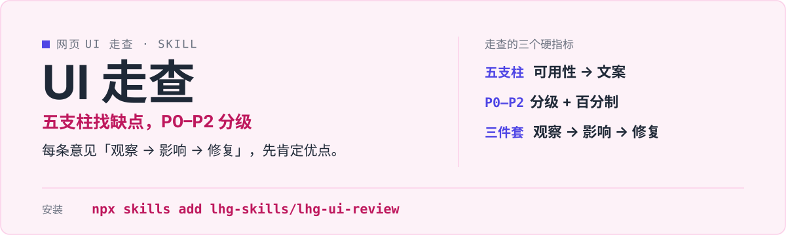

<p align="center">
  
</p>

# lhg-ui-review · 网页 UI 专家走查

给网页做专家级设计走查：截图 / 代码 / 链接三种输入，五支柱（可用性 / 视觉层级 / 一致性 / 无障碍 / 文案）系统找缺点，P0–P2 分级 + 百分制评分，每条意见按「观察 → 影响 → 修复」输出可执行指导。

（SKILL.md v1.1.1）

## 它是什么

- 三种输入：截图 / 代码 / 链接。
- 第一印象扫描（2 秒 + 眯眼测试），再进五支柱走查：可用性 / 视觉层级 / 一致性 / 无障碍 / 文案 + 中文排版专项 + 「AI 味」反模式清单。
- 分级与评分：P0 / P1 / P2 + 百分制，3 个高影响修复置顶。
- 每条意见「观察 → 影响 → 修复」三件套，先肯定优点；截图确立不了的标「未验证」。

## 先试一句

| 你说 | 它给你 |
|---|---|
| 看看这个页面 | 2 秒第一印象 + 眯眼测试，再五支柱走查 |
| 评审一下这个 UI | P0–P2 分级 + 百分制，3 个高影响修复置顶 |
| 这个设计有什么问题 | 每条意见观察 → 影响 → 修复，先肯定优点 |

## 安装

```bash
npx skills add lhg-skills/lhg-ui-review
```

<details>
<summary>发给 Agent 的安装话术（推荐：小白用户直接复制整段发给你的 Agent）</summary>

> 请帮我安装 Skill「lhg-ui-review」：先从 Gitee 上 lhg-skills 组织下的 lhg-ui-review 仓库下载；如果 Gitee 无法访问或下载失败，改从 GitHub 上 lhg-skills 组织下的同名仓库下载。按当前 Agent 的规范安装其中的 Skill，优先全局安装，保留完整目录和依赖。请直接执行，完成后验证是否安装成功，告诉我实际使用的来源、安装的版本号以及如何调用；遇到访问或安装限制请说明具体原因。需要输入管理员密码或确认风险时停下来等我。

**怎么算装好了**：Agent 能在已安装的 Skill 里看到 `lhg-ui-review`，并报出版本号（与仓库 `SKILL.md` 的 `version` 一致）。只是打开了仓库网页不算安装。

</details>


## 它怎么做

1. 判模式
2. 输入定级与证据边界
3. 第一印象扫描
4. 五支柱走查
5. 分级与评分
6. 输出（三件套）
7. 双模式交付（评审报告版 / 可执行修复清单版）

五阶段评审流程借鉴 duboc/agy-skills 的 design-critique（Apache-2.0）；眯眼测试与一致性审计借鉴 black141312/ada 的 ui-review（MIT）；「AI 味」反模式清单为独立撰写。

## 什么时候用 / 不用

**用它，当你：**

- 上线前检查页面、评审 UI 设计
- 要分级 + 评分知道先改哪 3 处
- 要可执行的修复意见，不是空泛评价

**别用它，当你：**

- 只给一张模糊截图还想要确定结论——确立不了的会标「未验证」
- 只要夸奖——它先肯定优点，但缺点照样列
- 要它直接改代码——它输出评审与修复清单

## 目录结构

```
SKILL.md            skill 全文
references/
  critique-framework.md  走查框架
  smoke-test.md          自检用例
  fixtures/              4 个对照用例
scripts/
  smoke_test.py          冒烟脚本
LICENSE             MIT
manifest.yaml
icon-512.png
```

## 自检与反馈

冒烟：`python3 scripts/smoke_test.py references/fixtures/fixture-review-good.md`（另有缺优点、缺三要素、缺未验证声明 3 个坏用例，见 [references/smoke-test.md](references/smoke-test.md)；全部用例 2026-10-01 实测通过）。

发现问题请提 issue：[提一个 issue](https://github.com/lhg-skills/lhg-ui-review/issues/new)（标题以 `[QC] ` 开头，写清你让它做了什么、它实际给了什么）。

---

## 出品：刘洪光

本 skill 由真人出镜 IP「刘洪光」（安徽合肥）出品，归属 [lhg-skills](https://github.com/lhg-skills)。

- GitHub 主页：https://github.com/lhg-skills —— 全部 skill 开源在此，欢迎 star
- 抖音：搜「刘老师讲AI实战」
- 微信：lhgsmsw

觉得有用，欢迎点 ⭐ Star。
